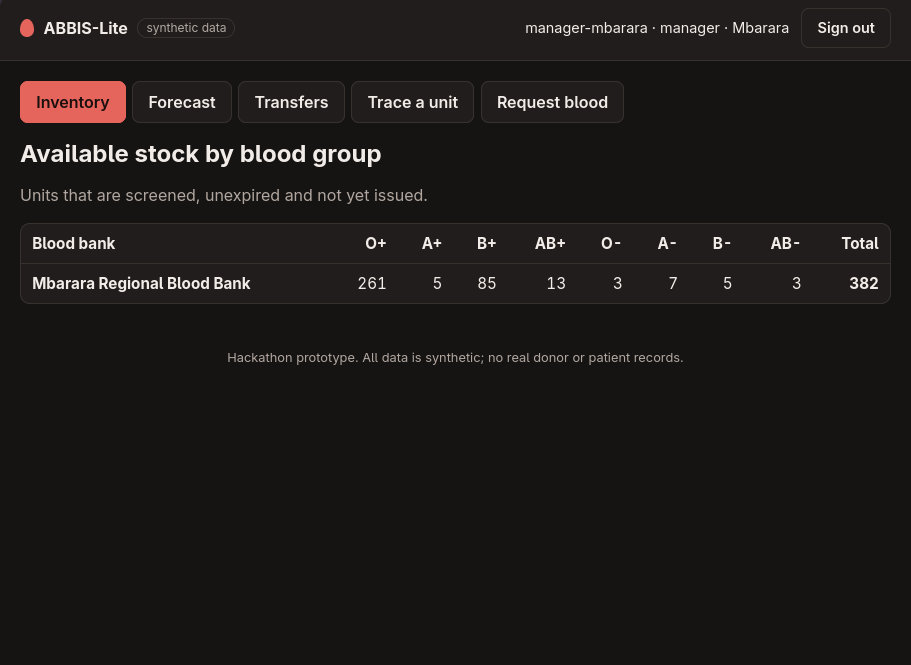
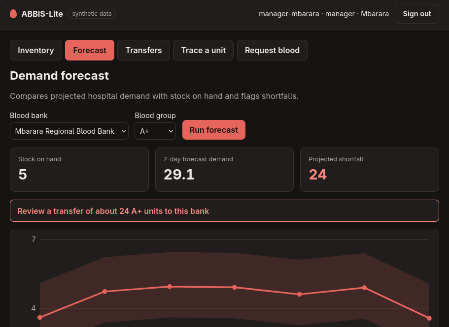
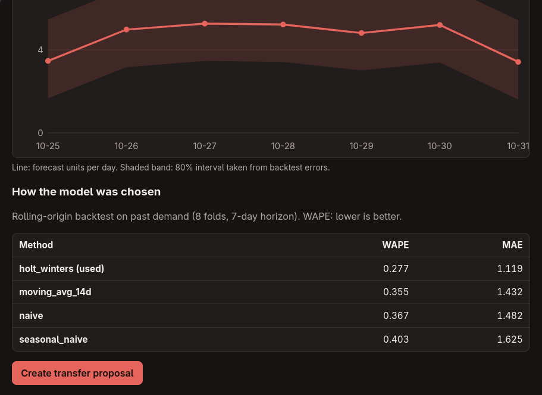
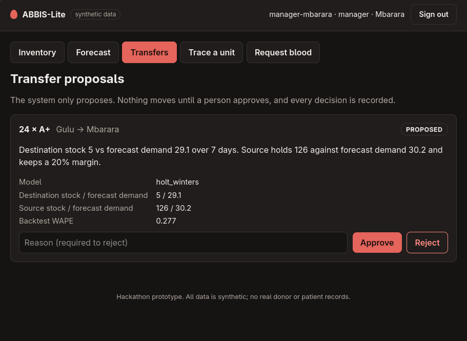
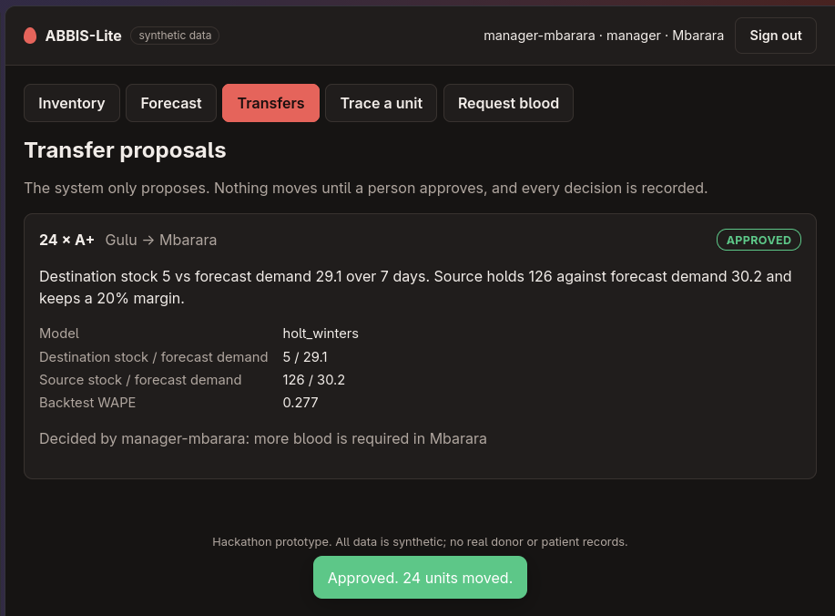

# ABBIS-Lite

[](https://github.com/2025bcs068-prog/abbis-lite/actions)

A working technical slice of an interoperable blood-bank information system for African health systems,
built for the Terumo BCT Africa Hackathon 2026. **All data is synthetic. No real donor or patient records.**

## The problem
Blood units expire in one facility while another faces a shortage. Stock data is siloed, partly paper-based,
and unreliable over weak connectivity, so nobody can trace a unit from vein to patient or forecast shortages.

## What it does
Donor registration → collection → lab screening → inventory → hospital request → issue (first-expiry-first-out),
with a full audit trail per unit, offline-safe writes, role-based access, and AI demand forecasting that
**proposes** inter-bank transfers which a human must approve.

| Capability | How |
|---|---|
| Unit-level traceability | Every state change writes an audit event attributed to a real identity; `GET /units/{code}/trace` |
| Works through outages | Local outbox queue + idempotent replay (`client/outbox.py`) |
| Less wastage | FEFO issuing; forecast-driven transfer suggestions |
| Safe AI | Backtested forecasts, uncertainty bands, explanations, rule-based fallback, mandatory human approval |
| Security | JWT login, 5 roles, facility scoping, login lockout, strict CSP on the dashboard |

## Screenshots (manager of Mbarara Regional Blood Bank)
**Stock by blood group**


**Forecast flags a shortfall of A+ units**


**How the model was chosen: backtest against simple baselines**


**The system proposes a transfer, a person decides**



## Quick start
```bash
git clone https://github.com/2025bcs068-prog/abbis-lite && cd abbis-lite
python3 -m venv .venv && source .venv/bin/activate
pip install -r requirements.txt
python -m data.generate_synthetic      # a year of synthetic data, 4 banks, and demo users (passwords printed once)
python -m data.make_shortage           # optional: stage a shortage for the transfer demo
uvicorn app.main:app                   # dashboard at http://127.0.0.1:8000, API docs at /docs
python -m pytest -q                    # 24 tests
```
Demo logins are saved to `demo_credentials.json` (gitignored). Set `ABBIS_JWT_SECRET` in production.
`DATABASE_URL=postgresql+psycopg://...` switches from SQLite to PostgreSQL.

| Demo user | Role | Sees |
|---|---|---|
| `manager-mbarara` | bank manager | own bank stock, forecasts, transfers, trace, requests |
| `coordinator` | national coordinator | all banks, forecasts, transfers |
| `clinic-mbarara` | clinic | own bank stock, trace |
| `hospital-a` | hospital | stock, blood requests |

## Demo 1: working through an outage
`python -m demo.offline_demo`: the clinic queues work offline, a dead network pauses sync, an expired login keeps the
queue intact, then everything replays in order. A full replay creates no duplicates, and a conflicting operation
(donor too soon) is flagged for a human instead of being retried.

## Demo 2: AI proposes, a human decides
`python -m demo.transfer_demo` (or use the dashboard). The model forecasts a 7-day shortfall at one bank, proposes
moving units from a bank with a safe surplus, explains why, a manager approves, units move, and approving twice is refused.

## Forecast evaluation (synthetic data)
Rolling-origin backtest, 8 folds, 7-day horizon, WAPE (lower is better). Mbarara, blood group A+:

| Method | WAPE |
|---|---|
| **Holt-Winters (damped, weekly seasonality)** | **0.277** |
| 14-day moving average | 0.355 |
| Naive | 0.367 |
| Seasonal naive | 0.403 |

The demand pattern is synthetic, so this validates the pipeline (backtesting, intervals, fallback), not real-world
accuracy. If backtest error exceeds 0.5 the service falls back to a transparent 14-day average and flags low confidence.

## Architecture
See [`docs/architecture.md`](docs/architecture.md): components, FHIR mapping, failure modes, security, adaptability, pilot pathway.


## Roadmap
FHIR facade · USSD/SMS donor and low-stock alerts · anomaly detection on stock events · forecast drift monitoring ·
compatible-group substitution · CI pipeline · pilot design.

## Team (focus areas)
| Member | GitHub | Focus |
|---|---|---|
| Biyimbwa Elijah Simwogerere | [@2025bcs068-prog](https://github.com/2025bcs068-prog) | Architecture, backend, security |
| Kissa Keith Ndiema | [@veritasndiema-ctrl](https://github.com/veritasndiema-ctrl) | Backend, deployment, AI/data |
| Kisembo Stephen | [@stephenkisembo19-debug](https://github.com/stephenkisembo19-debug) | AI/data, front end |
| Okori Sadrach | [@2025bcs205-lang](https://github.com/2025bcs205-lang) | AI/data |
| Tusiime Betty | [@fernabetty](https://github.com/fernabetty) | Front end |
