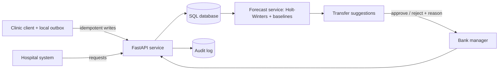

# ABBIS-Lite: Architecture

A working technical slice of an interoperable blood-bank information system, built for the Terumo BCT Africa Hackathon 2026.
All data is synthetic. No real donor or patient records are used.

## 1. Problem and user need
Blood units are lost to expiry in one facility while another faces shortage. Stock data is siloed, partly paper-based,
and unreliable over weak connectivity, so no one can trace a unit from vein to patient or forecast shortages.
Users: clinic staff (collect and screen), blood-bank managers (inventory, approvals), hospitals (requests), national coordinators (oversight).

## 2. End-to-end workflow
Donor registration -> collection -> lab screening -> inventory -> hospital request -> issue (first-expiry-first-out).
Each step is an idempotent API call that writes an audit event keyed by unit.
A forecasting service reads demand history and proposes inter-bank transfers, which a human approves or rejects.

## 3. Components
| Component | Purpose |
|---|---|
| `app/main.py` | Traceability API: donors, collection, screening, inventory, requests, trace |
| `app/api/transfers.py` | AI-suggested transfers with mandatory human decision |
| `app/ai/forecast.py` | Demand forecasting, rolling-origin backtest, uncertainty bands, fallback |
| `client/outbox.py` | Offline-first client queue with ordered, idempotent replay |
| `data/generate_synthetic.py` | Synthetic multi-bank dataset (respects donor-interval rule) |

## 4. Data model and interoperability
Entities: BloodBank, Donor (pseudonymous code), BloodUnit (unit-level identity and status lifecycle),
ScreeningResult, HospitalRequest, TransferSuggestion, AuditLog.
Intended FHIR R4 mapping (not yet exposed as FHIR endpoints):

| ABBIS-Lite | FHIR resource |
|---|---|
| Donor | Patient (pseudonymised) |
| BloodUnit | BiologicallyDerivedProduct |
| ScreeningResult | Observation |
| HospitalRequest | ServiceRequest |
| Issue / transfer | SupplyDelivery |

Unit lifecycle: collected -> screened -> available -> issued | discarded. Positive screening discards a unit automatically.

## 5. Unreliable infrastructure
- Every write carries a `client_op_id`. The server stores the result and replays it on retry, so duplicates are impossible by design.
- The client queues operations locally and replays them in order. A network or 5xx failure stops the sync and preserves order.
- A 4xx business conflict (e.g. donor too soon) marks the operation `rejected` for a human, and it is never retried blindly.
- Facility-assigned unit codes let a clinic label and screen a unit before it ever reaches the server.
- Demonstrated by `python -m demo.offline_demo` and `tests/test_outbox.py`.

## 6. AI and data approach
- **Use case:** per bank and blood group demand forecasting; stock-versus-demand gap drives a transfer suggestion.
- **Inputs:** historical daily hospital request volumes, current non-expired stock.
- **Models:** naive, seasonal-naive, 14-day moving average, damped Holt-Winters with weekly seasonality. The best on backtest is chosen per series.
- **Evaluation:** rolling-origin backtest (8 folds, 7-day horizon), measured with WAPE and MAE. WAPE is used because demand contains zero days, which breaks MAPE.
  On the synthetic demo series Holt-Winters reached WAPE 0.23 versus 0.28 for the best baseline and 0.31 for naive. The data is synthetic, so this validates the pipeline, not real-world accuracy.
- **Explainability:** every suggestion stores its rationale (stock, forecast, model, backtest error, source surplus after safety margin).
- **Uncertainty:** 80% interval from backtest residuals.
- **Human oversight:** a suggestion is only a proposal. Approval or rejection (reason required) is recorded with actor and time, and only approval moves units.
- **Fallback:** if backtest error is high (WAPE > 0.5) the service switches to a transparent 14-day-average rule and flags low confidence.
- **Monitoring (planned):** compare forecasts to realised demand weekly; alert on WAPE drift and retrain.

## 7. Security
Implemented: pseudonymous donor codes, audit trail on every state change, input validation, synthetic data only.
Planned: JWT authentication, role-based access (clinic / manager / hospital / coordinator),
per-facility data scoping, TLS, encryption at rest, rate limiting.
**Current limitation:** the actor is taken from an `X-Actor` header as a placeholder. Real identity comes with authentication.

## 8. Where it can fail (and the response)
| Failure | Effect | Handling |
|---|---|---|
| Network loss | Writes cannot reach server | Local outbox queues and replays in order |
| Lost acknowledgement | Client retries | Idempotency key returns the stored result |
| Two simultaneous retries of one key | Unique-constraint error | Known gap: catch the integrity error and replay (next fix) |
| Stale suggestion (stock changed) | Over-transfer risk | Approval re-checks eligible stock and returns 409 |
| Forecast unreliable | Bad suggestions | Backtest gate plus rule-based fallback, human approval |
| Sparse or missing demand data | No forecast | Refuses below 90 days of history |
| Clock skew on offline devices | Misordered events | Server assigns authoritative timestamps; the queue preserves order |

## 9. Adaptability and scale
- Per-country configuration (shelf life, donor interval, required screening tests) to be moved from constants into configuration.
- Multi-tenant bank scoping, SQLite -> PostgreSQL (supported through `DATABASE_URL`), read replicas for reporting.
- FHIR facade and HL7/LIS adapters for existing systems; compatible-group substitution (e.g. O-) in issuing.

## 10. Implementation pathway
1. Controlled pilot: one regional bank and two hospitals, offline-capable clinic client, manual-approval transfers.
2. Add authentication, FHIR endpoints, monitoring dashboard.
3. Integrate with existing LIS/HMIS; run forecasts on real (approved, de-identified) data with clinical review.
4. Expand to a regional network; add national coordinator views.
